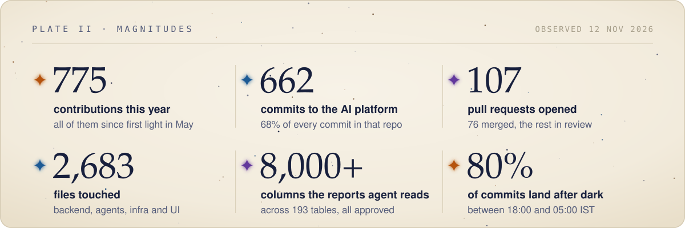
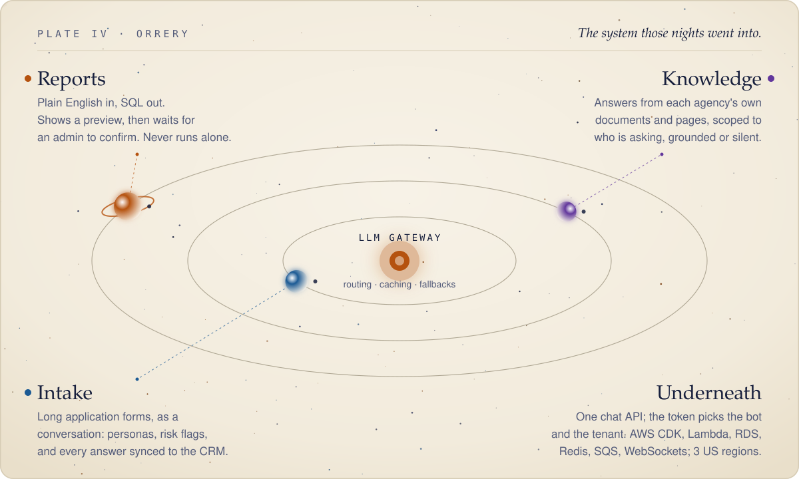

<picture>
  <source media="(prefers-color-scheme: dark)" srcset="assets/dark/hero.svg">
  
</picture>

 

> [!NOTE]
> **Why this profile looks empty.** This is my work account, and apart from this page everything it holds is private. The plates below are drawn from the git history behind it.

 

## ✦ Field notes

I'm an AI engineer at **Telomere**. Most of my time goes into a **multi-tenant AI platform for fertility and surrogacy agencies**. It has three assistants behind one API:

- **Intake** turns long application forms into a conversation.
- **Knowledge** answers questions from each agency's own documents.
- **Reports** lets an admin ask for a report in plain English. It writes the SQL, shows a preview, and runs the query only after the admin confirms.

I wrote most of that codebase: two of every three commits, the agent loops, the safety gates, the AWS infrastructure, and the tests and runbooks around them. Most of it was written at night, as the sky chart below shows.

 

<picture>
  <source media="(prefers-color-scheme: dark)" srcset="assets/dark/magnitudes.svg">
  
</picture>

  

<picture>
  <source media="(prefers-color-scheme: dark)" srcset="assets/dark/sky.svg">
  
</picture>

  

<picture>
  <source media="(prefers-color-scheme: dark)" srcset="assets/dark/orrery.svg">
  
</picture>

<b>The orrery, in words</b>

 

| Body | What it does | How it stays honest |
| :--- | :--- | :--- |
| **LLM gateway** | One gateway for every model call: per-bot keys, routing, prompt caching, fallbacks | Self-heals when a model disappears; no bot calls a provider directly |
| **Reports** | An agentic tool loop that turns an admin's question into SQL over a 193-table schema | Grammar-checked against the product's own report builder; preview first, and nothing runs until an admin confirms; long turns go async over SQS and WebSockets |
| **Knowledge** | Answers from the agency's knowledge base, scraped pages and uploaded documents | Scoped by audience (intended parents, surrogates, donors); a grounding pass checks each reply against its sources |
| **Intake** | Walks applicants through the agency's real forms as a chat, in the right persona | Deterministic YAML rules plus LLM consistency checks raise risk flags, and every answer syncs back to the CRM |
| **Underneath** | JWT tenant routing, Python and FastAPI, React and TypeScript, MySQL, Redis | AWS CDK per environment, staging plus up to three production regions, pytest and Playwright end to end |

 

<picture>
  <source media="(prefers-color-scheme: dark)" srcset="assets/dark/spectra.svg">
  
</picture>

<b>Every line in the spectra, as text</b> (searchable)

 

- **Languages.** TypeScript, Python, JavaScript, C#, Rust, SQL, Bash, HTML & CSS, SCSS, Cypher, HCL, Google Apps Script
- **Frontend & UI.** React, Next.js, Angular, Astro, Svelte 5, Vite, Create React App, Tailwind CSS, Sass, Bootstrap, Radix UI, shadcn/ui, React Aria, Framer Motion, TanStack Query, Zustand, React Router, RxJS, Storybook, Lucide, Quill, Swiper, remark / rehype, Transloco i18n, View Transitions API, JSON-LD / schema.org, Satori, resvg, cmdk, CodeMirror, Sonner, Liquid Glass (SVG lensing)
- **Charts & dataviz.** Recharts, Observable Plot, uPlot, Apache ECharts, Charts.css, Matplotlib, Seaborn, Plotly
- **Backend & APIs.** Node.js, Fastify, NestJS, Express, FastAPI, Starlette, Flask, Uvicorn, Gunicorn, ASP.NET Core, .NET 8 / 10, Socket.IO, WebSockets, SignalR, Server-sent events, AG-UI event stream, OpenAPI / Swagger, Zod, Pydantic, class-validator, Joi, JWT, OpenID Connect, ASP.NET Identity, Argon2, bcrypt, Helmet, Rate limiting, BullMQ, Hangfire, APScheduler, Lease-based job queue, node-cron, Polly, AutoMapper, Multer, Axios / httpx, aiohttp, Flurl, reqwest, tokio, serde, thiserror, parking_lot, chrono
- **AI & LLM systems.** OpenAI API, Anthropic Claude, Google Gemini, Ollama, LM Studio, Pydantic AI, OpenRouter, LangChain, RAG pipelines, Text-to-SQL agents, MCP servers, LLM guardrails, Prompt & schema contracts, Model cascades, Prompt caching, pydantic-evals, Arize Phoenix, sentence-transformers, fastembed, FAISS, BM25, Reciprocal rank fusion, Weaviate, tiktoken, natural / compromise NLP, fuzzy matching, faster-whisper, Vosk, SpeechBrain, Piper TTS, edge-tts, pyttsx3
- **Machine learning & data science.** PyTorch, torchvision, TensorFlow, Keras, scikit-learn, imbalanced-learn, SHAP, NumPy, pandas, SciPy, scikit-image, joblib, h5py, ndarray (Rust), ONNX, ONNX Runtime, Jupyter, yfinance, jStat, Federated learning, CNNs, RNNs & GRUs, GANs, Anomaly detection
- **Vision, audio & documents.** OpenCV, YOLO / Ultralytics, MediaPipe, dlib, supervision, Pose & posture estimation, PPE detection, ANPR (number plates), Multi-signal threat scoring, Pillow, imutils, RTSP ingest, FFmpeg, PyAV, MoviePy, sounddevice / pydub, EasyOCR, Tesseract, PyMuPDF, pdfplumber, PyPDF2, pdf-parse / pdf.js, Docnet, ReportLab, python-docx, EPUB (VersOne), NetVips, sharp, node-canvas, QR codes, ExcelJS / xlsx, openpyxl, CsvHelper
- **Data stores & ORMs.** PostgreSQL, MySQL / MariaDB, Redis, SQLite, SQLite FTS5, Neo4j, MinIO / S3, Weaviate (vector), FAISS (vector), pgvector, Supabase, Prisma, Drizzle ORM, SQLAlchemy, Alembic, asyncpg, psycopg, sqlglot (SQL ASTs), Entity Framework Core, PL/pgSQL, PostgreSQL row-level security, JSONB storage, cache-manager / EasyCaching, Google Sheets as a store
- **Infrastructure & delivery.** Docker, Docker Compose, Kubernetes, Helm, Terraform, Ansible, AWS, AWS CDK, AWS Lambda, Amazon SQS, API Gateway WebSockets, Mangum, Amazon EKS, Amazon RDS, ElastiCache, Amazon ECR, VPC networking, vSphere, Nginx, GitHub Actions, Dependabot, GitHub Pages, GitHub Releases, Signed auto-updates, NSIS & DMG installers, Relocatable Python runtime, Docker Buildx, crane, Turborepo, pnpm workspaces, npm workspaces, uv, Make, Air-gapped, zero-trust deploys
- **Observability & security.** Prometheus, Grafana, Loki & Promtail, OpenTelemetry, Arize Phoenix tracing, Pino, Winston, Loguru, Serilog, tracing (Rust), Trivy, oauth2-proxy, OS credential store (keyring), Content Security Policy, Secret & PII detection, CodeQL / SARIF, SonarAnalyzer, Codecov, Husky & lint-staged, commitlint, pre-commit, AES-GCM / ring, rustls, cryptography (py), SHA-2 / HMAC, Data Protection API
- **Testing & code quality.** Vitest, Jest, pytest, pytest-asyncio, Playwright, Selenium, Testing Library, jsdom, Supertest, xUnit, NSubstitute, BenchmarkDotNet, criterion (Rust), cargo test, Clippy (pedantic), rustfmt, svelte-check, Golden-set evals, Metamorphic SQL probes, Karma, ESLint, typescript-eslint, Prettier, Ruff, Black, mypy, Pylint, flake8, markdownlint, Storybook a11y
- **Desktop, edge & automation.** Tauri 2, Electron, electron-vite, electron-builder, System tray & menu bar apps, Win32 power requests, IOKit / Core Foundation, Global hotkeys, PySide6 / Qt, Tkinter, Streamlit, NiceGUI, Rust edge agent, sysinfo, Windows API (Rust), Playwright automation, Selenium scraping, BeautifulSoup / lxml, Cheerio, HtmlAgilityPack, SurveyCTO, ngrok
- **Integrations & services.** Twilio, WhatsApp & Instagram channels, Nodemailer, MailKit, Google Sheets API, Google Calendar, Apps Script / clasp, Naukri.com automation, OpenGraph & sitemaps, Webhooks

 

## ✦ Catalogue

The objects in the plates above, numbered the way astronomers number theirs. Both are private, so they are described here rather than linked.

| No. | Object | What it is | Instruments |
| :-- | :-- | :-- | :-- |
| `BJP 001` | **Agency AI platform** private · work | The system in the orrery: intake, knowledge and reports assistants for fertility and surrogacy agencies, with one gateway and one API | Python · FastAPI · React · AWS CDK · MySQL · Redis |
| `BJP 002` | **Reports agent** private · work | Plain-English reporting over 193 tables and 8,000+ approved columns. Every query is grammar-checked, previewed, and confirmed by an admin before it runs | sqlglot · agentic tool loop · SQS · WebSockets |

 

## ✦ Observing rules

1. **Preview before it runs.** When an AI writes against real data, it shows its work and waits for a person.
2. **No model where a rule will do.** A deterministic check is cheaper, faster, and never hallucinates.
3. **Numbers come with their conditions.** Every figure on this page is computed from git history or a results file.
4. **Write it down.** Specs, decision records and handoff notes ship with the code, so the next person starts where I stopped.

 

<picture>
  <source media="(prefers-color-scheme: dark)" srcset="assets/dark/dawn.svg">
  
</picture>

Every plate is drawn by <a href="scripts/draw.py"><code>scripts/draw.py</code></a> from <a href="data/">data/</a>, and switches between a night sky and a printed star atlas with your theme. Observed 12 Nov 2026.

